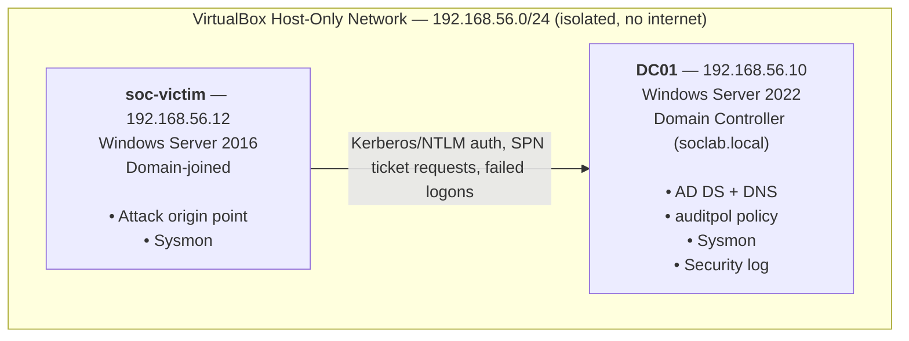

# Cybersecurity Detection Lab

A self-built Active Directory attack-and-detection lab, run entirely in VirtualBox. I built a real domain controller, configured Windows and Sysmon logging to actually catch attacker behavior, then attacked my own domain in two common ways (password spraying, Kerberoasting) to verify the detections hold up against the real Windows Security log, not just against theory.

This isn't a tutorial walkthrough. Every finding below was independently reproduced and verified against actual event log output. Two of the three findings came directly out of debugging something that didn't work as expected, which I've kept in rather than smoothed over, since that troubleshooting is the part that actually mirrors SOC work.

## Table of contents

- [Architecture](#architecture)
- [Environment](#environment)
- [Setup](#setup)
- [Findings](#findings)
  1. [4625 alone misses most password-guessing attempts](#1-event-id-4625-alone-misses-most-domain-password-guessing-attempts)
  2. [A correct IP proves nothing about real connectivity in a hypervisor](#2-a-correctly-assigned-static-ip-says-nothing-about-real-layer-2-connectivity-in-a-hypervisor)
  3. [Kerberoasting needs no privilege, and RC4 is the proof](#3-kerberoasting-needs-no-privilege-escalation-and-the-rc4-encryption-type-is-the-proof-not-the-crack)
- [Skills demonstrated](#skills-demonstrated)
- [Full writeup](#full-writeup)
- [Roadmap](#roadmap)

## Architecture



**Why this topology matters:** attacks run *from* `soc-victim` *against* `DC01`, over the network, the same direction a real compromised workstation would attack a domain controller. Nothing in the attack exercises runs locally on the DC. Detection is done directly against the DC's own Security log via `Get-WinEvent` — no intermediate log collector, so every finding below is traced straight back to a real, unprocessed Windows event.

## Environment

| VM | Role | OS | IP |
|---|---|---|---|
| `DC01` | Domain controller for `soclab.local` | Windows Server 2022 Standard Evaluation | `192.168.56.10` |
| `soc-victim` | Domain-joined workstation, attack origin | Windows Server 2016 | `192.168.56.12` |

Both sit on an isolated VirtualBox **Host-Only** network, no internet access on that segment. Files are moved in through shared folders rather than downloaded directly on the VMs, which keeps the lab genuinely air-gapped and mirrors how a real segmented environment restricts egress.

## Setup

Brief version — the full command-by-command version with real output is in the [writeup](docs/audit-policy-and-logging.md).

1. **Domain controller** — Windows Server 2022, promoted to a new forest (`soclab.local`), DNS installed alongside AD DS.
2. **Audit policy** — `auditpol` enabled across Logon, Account Management, Kerberos Authentication Service, Kerberos Service Ticket Operations, Directory Service Changes, and Process Creation, plus the less obvious ones (Group Membership, File Share, Directory Service Replication) that most quick-start guides skip.
3. **Command-line visibility** — `ProcessCreationIncludeCmdLine_Enabled` registry key enabled, plus PowerShell Script Block Logging (Event ID 4104), so Event 4688 actually shows what a process was *told* to do, not just that it ran.
4. **Sysmon** — installed with SwiftOnSecurity's community config, verified against real Event ID 1 output (hashes, parent process chain, integrity level, working directory).
5. **Second machine** — `soc-victim` built, networked, and domain-joined, specifically so attack traffic crosses the network instead of running locally on the DC.
6. **Service account target** — `svc.backup` created and given a Service Principal Name, simulating the common misconfiguration that makes an account Kerberoastable.

## Findings

### 1. Event ID 4625 alone misses most domain password-guessing attempts

I ran a deliberate failed logon:

```powershell
net use \\DC01\IPC$ /user:SOCLAB\carol.white WrongPass123!
```

Expecting Event ID 4625. A filtered query for 4625 over the last 15 minutes returned nothing.

The actual event was logged as **4771** (Kerberos pre-authentication failed), Failure Code `0x18` (bad password). Domain-joined Windows clients negotiate **Kerberos first** — Kerberos auth failures log as **4768** or **4771**, never 4625. **4625/4776 only fire for NTLM**, which a modern domain client only falls back to in narrow circumstances.

Repeating the attempt across three lab accounts in quick succession produced three 4771 events — same timestamp, same failure code, different accounts, the actual spray signature:

```
TimeCreated     Id     Account
1:04:52 AM     4771   alice.smith
1:04:52 AM     4771   bob.jones
1:04:52 AM     4771   carol.white
```

**Takeaway:** a correct password-spray/brute-force rule has to watch **4625, 4771, 4768, and 4776 together**, counting distinct failed accounts per source within a short window — not just filter on 4625, which a lot of introductory material treats as sufficient on its own.

### 2. A correctly-assigned static IP says nothing about real Layer 2 connectivity in a hypervisor

Two VMs had matching static IPs on `192.168.56.x`, correct masks, DNS pointed at the DC — and couldn't reach each other (`ping`: 100% loss, then intermittent `Error due to lack of resources`). Firewall rules checked out on both ends (`Get-NetFirewallRule` showed ICMP enabled). Nothing wrong was visible from inside either guest OS.

Root cause, found in VirtualBox's own configuration rather than Windows:

1. `DC01`'s Adapter 1 was attached to **NAT**, not Host-Only. NAT in VirtualBox is per-VM and isolated — the machine could ping itself but nothing else, a strong tell for this exact misconfiguration.
2. Separately, the **Host-Only virtual switch itself** was configured with IPv4 `192.168.235.1`, not `192.168.56.1`. Both VMs' static IPs assumed a `192.168.56.0/24` network the switch wasn't actually serving.

Fixed by correcting the Host-Only network's address in VirtualBox's Network Manager and explicitly re-attaching both adapters to it. Result: 0% packet loss, correct `Resolve-DnsName` output, clean domain join.

**Takeaway:** an IP set inside a guest OS says nothing about which virtual switch the adapter is actually wired to underneath. When connectivity fails and the guest-level config looks correct, check the hypervisor's network layer next, not the firewall again.

### 3. Kerberoasting needs no privilege escalation, and the RC4 encryption type is the proof, not the crack

Gave `svc.backup` an SPN:

```powershell
setspn -A MSSQLSvc/soc-victim.soclab.local:1433 svc.backup
```

simulating the common real-world mistake of a service account carrying an SPN and a weak, static password. From a **non-admin, domain-authenticated session** on `soc-victim`, requested a service ticket for that SPN via .NET's `KerberosRequestorSecurityToken`, the same primitive tools like Rubeus wrap around.

Resulting Event 4769 on `DC01`:

```
Ticket Options:         0x40810000
Ticket Encryption Type: 0x17
Failure Code:           0x0
```

`0x17` = RC4-HMAC. RC4's session key is derived directly from the account's NTLM hash, no salt, no key stretching — exactly what makes a captured ticket crackable fully offline, with zero further contact with the domain, no lockout triggers, no additional logon events to catch. `Failure Code: 0x0` means this was a completely ordinary, successful ticket request, functionally identical to a real SQL service authenticating normally.

I stopped at confirming the encryption type rather than exporting the ticket and running it through an offline cracker — the RC4 finding, pulled directly from a real Security log event, is sufficient evidence of the vulnerability and its fix (`msDS-SupportedEncryptionTypes` restricted to AES, or migration to a gMSA with automatic password rotation) without needing to operate offensive cracking tooling end to end.

**Takeaway:** a real detection rule shouldn't fire on RC4 alone — plenty of legacy services legitimately use it. The stronger signal is one account requesting tickets for many distinct SPNs in a short window, or RC4 explicitly requested when the requesting account's own TGT was issued in AES.

## Skills demonstrated

- Windows Server / Active Directory administration: forest promotion, DNS, OU and account structure, SPN management
- Security auditing configuration: `auditpol`, registry-based command-line and script block logging, log retention sizing
- Endpoint telemetry: Sysmon deployment and config validation
- Log analysis: `Get-WinEvent` filtering, Security log event field interpretation (status/sub-status/failure codes), cross-referencing Kerberos vs. NTLM event paths
- Attack technique understanding: password spraying, Kerberoasting, SPN-based misconfigurations, Kerberos encryption type weaknesses
- Infrastructure troubleshooting: VirtualBox networking (NAT vs. Host-Only, virtual switch subnet configuration), domain join diagnostics
- Documentation: writing findings up clearly enough that someone else could reproduce and verify each one

## Full writeup

Every command run, the actual output captured, and the full reasoning behind each step is in [`docs/audit-policy-and-logging.md`](docs/audit-policy-and-logging.md) — also structured as a standalone study reference, with an Event ID cheat sheet, Kerberos/NTLM status and failure code tables, and a table mapping common attack patterns to the events that reveal them.

## Roadmap

- [ ] Add centralized log collection (a SIEM, e.g. Wazuh) so detections don't depend on manual `Get-WinEvent` queries
- [ ] Convert the password-spray and Kerberoasting findings into Sigma rules
- [ ] Add a proper client machine and attempt lateral movement (4648, 5140)
- [ ] Add an attacker-perspective VM (likely Kali) for a less one-sided simulation
